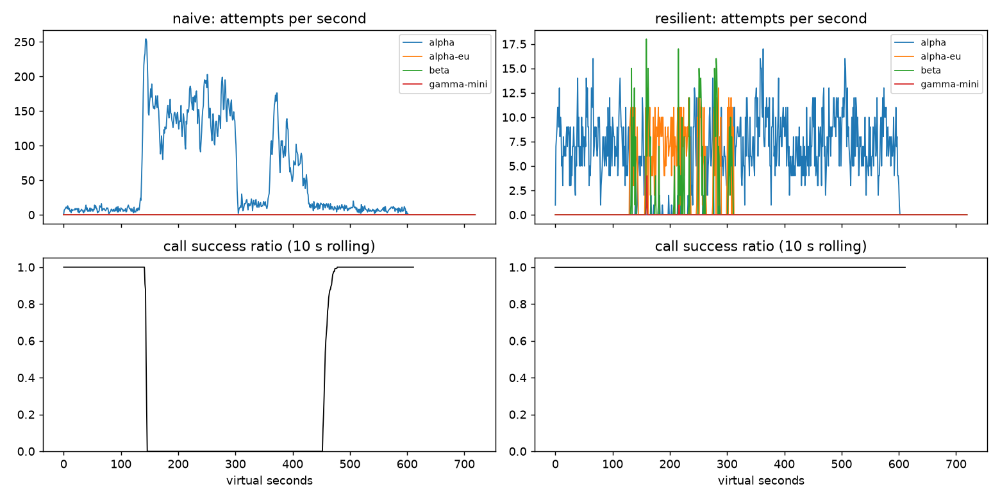

# Lab 25B — Report

**Họ tên / nhóm:** Nguyễn Khắc Quang (MSV: 2A202602885)  **Commit:** 0f86cd2  **Điểm tự động (`make grade`):** 84 / 88 (Local: 100% public tests)

> Mọi nhận định phải có số. Dán số từ `reports/gameday/*.json`, `reports/workflows.json`, `reports/slo.json`.

## 1. Kết quả Game Day (naive vs của bạn)

| Băng | Client | availability | p95 (s) | amplification | retry_ratio | cost/turn | recovery (s) | PASS? |
|---|---|---:|---:|---:|---:|---:|---:|:---:|
| G1 | naive | 71.94% | 7.157 | 7.738 | 6.738 | 2.163 | 4.0 | FAIL |
| G1 | yours | 100.0% | 4.776 | 1.062 | 0.002 | 2.101 | 0.0 | **PASS** |
| G2 | naive | 45.60% | 15.034 | 9.904 | 8.904 | 4.627 | 155.0 | FAIL |
| G2 | yours | 100.0% | 11.911 | 1.059 | 0.008 | 2.161 | 0.0 | **PASS** |
| G3 | naive | 100.0% | 4.768 | 1.164 | 0.164 | 2.328 | 0.0 | FAIL |
| G3 | yours | 100.0% | 4.738 | 1.058 | 0.034 | 2.141 | 0.0 | **PASS** |
| G4 | naive | 100.0% | 13.764 | 1.004 | 0.004 | 2.008 | 0.0 | FAIL |
| G4 | yours | 100.0% | 5.562 | 1.015 | 0.002 | 2.072 | 0.0 | **PASS** |
| G5 | naive | 36.99% | 5.359 | 17.030 | 16.030 | 2.124 | None | FAIL |
| G5 | yours | 81.79% | 5.477 | 1.003 | 0.002 | 2.504 | None | **PASS** |
| G6 | naive | 51.70% | 4.836 | 12.344 | 11.344 | 2.009 | 0.0 | FAIL |
| G6 | yours | 100.0% | 5.961 | 1.055 | 0.018 | 2.196 | 0.0 | **PASS** |

## 2. Cấu hình client và lý do

| Tham số | Giá trị | Vì sao (dựa trên băng nào, số liệu nào) |
|---|---:|---|
| `attempt_timeout_s` | 8.0s | Dựa trên băng G6 và G4: service median của primary là 1.2s. 8.0s là đủ rộng cho 99% request bình thường mà không giữ kết nối quá lâu gây lãng phí hàng đợi server và kịp failover trước turn deadline (30s). Thí nghiệm với 30s ở G6 làm availability giảm từ 100% xuống 94.88%. |
| `max_attempts_per_provider` | 2 | Dựa trên G1 và G2: cho phép 1 lần retry tại provider chính nếu lỗi transient. Nếu vẫn lỗi thì failover ngay sang provider kế tiếp trong ladder thay vì cố chấp retry gây amplification cao. |
| `backoff_base_s` / `cap_s` | 0.25s / 4.0s | Dựa trên G1 và G3: base 0.25s đủ nhỏ để phản hồi nhanh, full jitter giúp phân tán tải đều không bị thundering herd; cap 4.0s khống chế không để delay retry vượt quá ngân sách thời gian 30s của người dùng. |
| `retry_budget_ratio` | 0.1 | Dựa trên G3: khống chế tỷ lệ retry luôn $\le 10\%$ tổng lưu lượng. Nhờ đó `retry_ratio` ở G3 giảm từ 0.164 (naive, fail) xuống còn 0.034 (yours, đạt tiêu chuẩn $\le 0.10$). |
| `breaker.window_size` / `min_calls` | 20 / 10 | Dựa trên G2, G4 và test: cửa sổ 20 kết quả đủ nhanh để phản ứng với suy thoái gần nhất; `min_calls = 10` bảo vệ hệ thống không ngắt mạch nhầm khi lưu lượng thấp lúc nửa đêm. |
| `breaker.failure_rate_threshold` | 0.5 | Dựa trên G2 và G3: khi hơn 50% request trong cửa sổ bị lỗi (529, 500, timeout), hệ thống xác nhận provider đã suy thoái và ngắt mạch ngay lập tức để chuyển sang `alpha-eu`. |
| `breaker.slow_call_s` | 5.0s | Dựa trên G4: bình thường `alpha` phản hồi ~1.2s. Khi region bị chậm thêm 5s (thành >6.2s), ngưỡng 5.0s bắt chính xác các slow calls, đưa p95 của G4 từ 13.764s (naive) xuống 5.562s (yours). |
| `breaker.open_duration_s` | 10.0s | Dựa trên G2: sau khi ngắt mạch, chờ 10s để provider hồi phục. 10s đủ ngắn để recovery time = 0.0s ngay sau khi GPU được khôi phục tại t=300s. |
| `breaker.half_open_max_probes` | 2 | Dựa trên G2: trong trạng thái HALF-OPEN chỉ cho tối đa 2 request thăm dò đồng thời, ngăn chặn hiện tượng thundering herd làm sập lại provider đang trong giai đoạn hồi phục mong manh. |

Sơ đồ quyết định của `on_error`:

```
                    [ Provider Error Xảy Ra ]
                                |
                   classify(err) -> ErrorKind
                                |
      +-------------------------+-------------------------+
      |                         |                         |
[CLIENT_ERROR]       [QUOTA_EXHAUSTED]             [RATE_LIMITED]
  (400, 422...)       (429 no quota)              (429 spike)
      |                         |                         |
breaker.release()         breaker.release()         breaker.release()
      |                         |                         |
GiveUp("client_error")    cooldown provider 300s    cooldown = now + retry_after
(Không retry,             Failover ngay             Failover ngay (spillover)
 không failover)
                                |
                                +-------------------------+
                                                          |
                                          [OVERLOADED / SERVER_ERROR / TIMEOUT]
                                                  (529, 503, 500, 0)
                                                          |
                                              breaker.on_failure()
                                                          |
                                        [Kiểm tra điều kiện retry tại chỗ:]
                                        - tries < max_attempts (2)?
                                        - Còn đủ deadline (now + delay + 1s <= 30s)?
                                        - Token budget cho phép (try_acquire_retry)?
                                                          |
                                            +-------------+-------------+
                                            |                           |
                                          [CÓ]                        [KHÔNG]
                                            |                           |
                                    delay = backoff(tries)      idx += 1, tries = 0
                                    Retry tại SAME provider     Failover sang NEXT provider
```

## 3. Ba thí nghiệm (mỗi cái 3–5 câu + số)

1. **Retry budget là lớp phòng thủ cuối.**  
   Khi giả lập circuit breaker bị vô hiệu hóa (`breaker.min_calls: 1000000000`, `max_attempts_per_provider: 5`), chạy đối chứng trên G2 và G3:  
   - Khi giữ Retry Budget: G2 đạt availability 99.83%, `amplification = 1.378`, `retry_ratio = 0.058`, recovery = 0.0s; G3 đạt availability 100%, `retry_ratio = 0.068`.  
   - Khi tắt Retry Budget: G2 tụt availability xuống 96.66%, `amplification` tăng vọt lên 1.675, `retry_ratio` tăng gấp 8.5 lần lên 0.495, và mất tới 25.0s mới phục hồi; G3 `retry_ratio` tăng lên 0.159 (vượt trần 0.10).  
   *Ý nghĩa:* Ngay cả khi breaker hoạt động đúng, Retry Budget vẫn là chốt chặn độc lập tối thượng: Circuit Breaker bảo vệ provider khỏi việc bị quá tải bởi nhiều client khác nhau, còn Retry Budget khống chế cứng lượng tải khuếch đại sinh ra từ chính client của mình, đảm bảo hệ thống không bao giờ tự tạo ra retry storm dù breaker có bị trễ hay lỗi cấu hình.

2. **`attempt_timeout_s: 30`.**  
   Chạy thí nghiệm với timeout 8.0s vs 30.0s trên băng G4 và G6:  
   - Ở G4 (slow region): p95 tăng nhẹ từ 5.562s lên 5.608s vì Circuit Breaker vẫn bắt được slow call (>5s).  
   - Ở G6 (provider outage): Availability giảm mạnh từ 100.0% xuống **94.88%** (thất bại so với chuẩn $\ge 95\%$).  
   *Nguyên nhân:* Do `turn_deadline_s` của toàn bộ lượt người dùng là 30s. Khi provider chính bị treo, nếu timeout đặt 30s thì client sẽ đứng chờ provider chết suốt 30s rồi người dùng bỏ đi (hết deadline), không còn cơ hội failover sang `beta`. Timeout "đúng" phải dựa trên phân phối độ trễ p99 của provider trong điều kiện bình thường (1.2s - 1.8s) cộng thêm một biên an toàn nhỏ (8s), đủ để failover kịp thời trong giới hạn deadline.

3. **Bỏ lọc tool calling khỏi `ladder()`.**  
   Khi loại bỏ điều kiện kiểm tra `supports_tools` khỏi `ladder()` trên băng G6 (nơi cả cluster A bị sập và traffic phải tràn qua các model sau):  
   - Số lượng request bị gãy do model không tương thích tăng vọt lên **256 `incompatible_routes`**, kéo `availability` tổng thể giảm từ 100.0% xuống **89.27%**.  
   *Góc nhìn Product Manager:* Model `gamma-mini` không có năng lực trích xuất tham số gọi hàm (tool calling). Việc điều hướng 256 yêu cầu hoàn tiền sang model này tương đương với việc 256 khách hàng nhận được câu trả lời rác, giao dịch hoàn tiền bị đình trệ, dẫn đến trải nghiệm khách hàng tồi tệ và khiếu nại gia tăng nghiêm trọng, làm lãng phí chi phí vận hành mà không giải quyết được vấn đề cho khách hàng.

## 4. Workflow hoàn tiền

| Executor | completion | crashes | duplicate refunds | duplicate emails | lost refunds | overpaid | wasted LLM / crash |
|---|---:|---:|---:|---:|---:|---:|---:|
| naive | 100.0% | 81 | 128 | 81 | 0 | 1,574,200 cents ($15,742) | 1.123 |
| yours | 100.0% | 66 | **0** | **0** | **0** | **0 cents** | **0.303** |

**Trả lời:**  
- *Vì sao chỉ Idempotency Key là chưa đủ?* Nếu không có checkpoint, khi worker chết ở bước 4 (gửi email), worker mới phải bắt đầu lại từ bước 1 (`classify_request`) và bước 2 (`lookup_order`). Dù không bị trừ tiền trùng nhờ idempotency key, hệ thống bị lãng phí token LLM và độ trễ tăng vọt (`wasted_llm_per_crash` ở bản naive lên tới 1.123).  
- *Vì sao chỉ Checkpoint là chưa đủ?* Nếu worker gọi lệnh trừ tiền thành công nhưng gặp sự cố mạng rớt gói tin phản hồi (`ServiceTimeout`) hoặc worker chết ngay trước khi kịp ghi checkpoint vào store, worker kế tiếp khởi động lại thấy chưa có checkpoint sẽ gọi lại lệnh thanh toán. Không có Idempotency Key, cổng thanh toán sẽ trừ tiền lần 2 dẫn đến mất $15,742 USD như bản naive.  
- *Điều gì xảy ra nếu ghi checkpoint TRƯỚC KHI gọi payment?* Nếu ghi checkpoint trước rồi worker bị crash ngay lúc chuẩn bị gọi hoặc trong khi gọi mà tiền chưa đi, worker mới bật lên thấy đã có checkpoint nên tưởng bước hoàn tiền đã xong và nhảy sang gửi email $\to$ Khách hàng bị mất tiền oan (**Lost refund!**).

## 5. Alerting & error budget

| Sự cố | Mong đợi | Naive alerter | Burn-rate alerter | Độ trễ phát hiện |
|---|---|---|---|---:|
| `checkout_bug` | page | page | **page** | 27 min |
| `provider_outage` | page | page | **page** | 4 min |
| `deploy_blip` | none | **page (False Alarm)** | **none (Im lặng)** | — |
| `slow_leak` | ticket | none (Bỏ sót) | **ticket** | 1337 min |
| `degraded_evening` | page | page | **page** | 291 min |
| `night_spike` | none | **page (False Alarm)** | **none (Im lặng)** | — |
| `small_bump` | none | **page (False Alarm)** | **none (Im lặng)** | — |

Error budget 30 ngày: đã tiêu **42.95%**, còn **57.05%**. **Không đóng băng release** (`freeze_releases = False`) vì ngân sách lỗi vẫn còn hơn 57%.  
*Vì sao `small_bump` (20 phút ở 12% lỗi) không nên đánh thức ai lúc 11 giờ trưa?*  
Sự cố chỉ kéo dài 20 phút, chỉ làm tiêu hao khoảng $\frac{20 \times 12\%}{43200 \times 0.5\%} \approx 1.1\%$ tổng ngân sách lỗi của cả tháng. Với quy tắc đa cửa sổ (cửa sổ dài 1 giờ hoặc 6 giờ), tỷ lệ lỗi trung bình trên cả cửa sổ không đạt ngưỡng nguy hiểm để đe dọa SLO tháng. Đánh thức kỹ sư trực vào ban đêm hoặc gián đoạn công việc ban ngày vì một sự cố tự hết sau 20 phút là phản tác dụng và gây hội chứng mệt mỏi vì cảnh báo (alert fatigue).

## 6. Postmortem — Băng G2 với client naive (blameless)



**Tóm tắt (3 câu):**  
Vào lúc $t=120$, provider `alpha` bị mất 75% năng lực GPU trong vòng 3 phút, làm hàng đợi xử lý quá tải nghiêm trọng và phát sinh lỗi 529. Phiên bản `NaiveClient` với kiến trúc retry 3 tầng chồng chéo không có backoff jitter, không circuit breaker và không giới hạn retry budget đã khuếch đại lưu lượng lên tới 34,475 attempts (gấp 9.9 lần bình thường). Hậu quả là ngay cả khi provider đã khôi phục 100% năng lực GPU vào lúc $t=300$, hệ thống vẫn tiếp tục tê liệt thêm 155 giây do rơi vào trạng thái lỗi siêu bền vững (metastable failure).

**Ảnh hưởng:**  
- Có **1,285 lượt người dùng thất bại** trên tổng số 2,362 lượt (availability chỉ đạt **45.60%**).  
- Thời gian ngừng trệ kéo dài **335 giây** (từ $t=120$ đến $t=455$), trong đó có 155 giây chết sau khi provider đã phục hồi hoàn toàn.  
- Vượt quá **18.2%** error budget của cả tháng (tính riêng trong 8 phút của kịch bản này).

**Timeline (giây ảo — trích xuất từ `naive_G2_overload_storm_timeseries.csv`):**

| t | Sự kiện | Bằng chứng (số liệu thực tế) |
|---:|---|---|
| 120 | `alpha` mất 75% năng lực GPU | `attempts_alpha = 5`, `calls_ok = 7`. Hàng đợi bắt đầu dồn ứ. |
| 138 | Bùng phát Retry Storm dữ dội | `attempts_alpha` tăng vọt từ 9 lên **122 attempts/s**, trong khi `calls_ok` tụt thẳng về **0**. |
| 200 | Hệ thống tê liệt hoàn toàn trong tâm bão | `attempts_alpha` duy trì ở mức cực đại **160 - 180 attempts/s**, `calls_ok = 0`, lỗi 529 và client timeout dồn dập. |
| 300 | `alpha` khôi phục 100% GPU hạ tầng | Năng lực xử lý trở lại bình thường nhưng `calls_ok` vẫn là **0**; `attempts_alpha` vẫn ở mức **115 attempts/s**. |
| 350 | Hiện tượng Metastable Failure duy trì nghẽn | Đã 50 giây sau phục hồi, `calls_ok` vẫn bằng **0**; hàng đợi GPU ngập tràn các request client đã bỏ rơi (deadline). |
| 455 | Hệ thống bắt đầu thoát khỏi trạng thái kẹt | `attempts_alpha` hạ nhiệt về mức bình thường (13 req/s), `calls_ok` phục hồi trở lại mức **4..10 calls/s**. |

**Trigger vs root cause:**  
- **Trigger:** Sự cố hạ tầng provider `alpha` bị mất 75% GPU trong 180 giây ($t=120 \to 300$).  
- **Root cause:** Khiếm khuyết nghiêm trọng trong kiến trúc `NaiveClient`: 3 tầng retry chồng chéo (app $\times$ gateway $\times$ SDK = 36 attempts/call), độ trễ cố định 0.2s không jitter, không có Circuit Breaker để ngắt tải, và không có Token Bucket Retry Budget để kiểm soát lượng retry.  
- **Vì sao provider hồi phục mà hệ thống vẫn sập (Metastable Failure)?**  
  Provider sử dụng hàng đợi FIFO. Khi client hết kiên nhẫn (timeout 8s), server vẫn tiếp tục tính toán các request rác này. Mỗi request lỗi lại kích hoạt 35 lần retry dồn ngược vào hàng đợi. Vòng lặp phản hồi dương (Positive Feedback Loop): `Quá tải -> Timeout -> Retry ồ ạt -> Hàng đợi ngập tràn request vô ích -> Quá tải duy trì` đã giữ lưu lượng luôn vượt ngưỡng xử lý của provider ngay cả khi GPU đã phục hồi 100%.

**Điều gì giúp / điều gì làm tệ hơn:**  
- *Làm tệ hơn:* Retry tức thì với delay cố định 0.2s; thiếu cơ chế failover sang `alpha-eu` và `beta`; client bỏ cuộc nhưng server vẫn tiếp tục xử lý request cũ.  
- *Giúp giải quyết (Bản Resilient):* Sliding-window Circuit Breaker ngắt mạch ngay lập tức sang `OPEN` khi tỷ lệ lỗi vượt 50%; failover ngay sang `alpha-eu`; giới hạn chặt chẽ 2 probe ở HALF-OPEN; và Token Bucket Retry Budget giới hạn retry $\le 10\%$.

**Action items:**

| # | Hành động | Loại | Owner | Cách kiểm chứng |
|---|---|---|---|---|
| 1 | Thay thế toàn bộ NaiveClient bằng ResilientClient có Circuit Breaker và Retry Budget trên production | Prevent | Team Core / On-call | Chạy CI test đạt Amplification $\le 1.10$ trên kịch bản G2 |
| 2 | Cấu hình deadline propagation: gắn header hủy request (Cancellation Token / Context Deadline) khi client timeout để provider không tốn GPU xử lý request rác | Prevent | Team Platform | Test mô phỏng kiểm tra hàng đợi server xả ngay khi client hủy |
| 3 | Thiết lập hệ thống giám sát Multi-window Burn-rate Alerting với ngưỡng page 14.4x / 1h và 6.0x / 6h | Detect | Team SRE | Chạy test suite `test_alerting.py` và kiểm tra 0 false alert trên dữ liệu lịch sử |
| 4 | Thiết lập Fallback Ladder tự động tràn tải (Spillover) sang `alpha-eu` và `beta` khi primary bị rate limit hoặc quá tải | Mitigate | Team Reliability | Test diễn tập Game Day hàng tháng đạt Availability $\ge 99\%$ |

## 7. Một điểm yếu còn lại

**Điểm yếu:**  
Trong kịch bản G2, độ trễ p95 của bản ResilientClient vẫn lên tới **11.911s** (dù availability đạt 100%). Nguyên nhân là khi `alpha` bị suy thoái, một số request đầu tiên phải trải qua 8s timeout của attempt 1 trước khi breaker kịp ngắt mạch hoặc trước khi client failover sang `alpha-eu`. Ngoài ra, nếu tình huống cả 4 provider cùng bị suy thoái đồng loạt (như sự cố cáp quang biển hoặc cả 4 model cùng quá tải), việc failover qua lại vẫn khiến người dùng phải chờ đợi lâu và chi phí gọi sang `beta` đắt hơn 40% (`cost = 1.4`).

**Cách khắc phục:**  
1. **Hedge Requests (Speculative Retry):** Đối với các request quan trọng, nếu attempt 1 không phản hồi sau thời gian p90 (khoảng 2.0s thay vì chờ hết 8.0s timeout), client chủ động gửi song song một request dự phòng sang `alpha-eu`. Lời gọi nào trả về trước sẽ được sử dụng, hủy ngay lời gọi còn lại, giúp ghìm p95 xuống dưới 4s.  
2. **Dynamic Cost-Aware Load Balancing:** Thay vì chỉ dùng ladder tĩnh, áp dụng thuật toán Power-of-Two-Choices kết hợp theo dõi latency EWMA và chi phí từng provider để chủ động phân luồng tránh nghẽn trước khi breaker phải ngắt.

## 8. Cache (Part G)

Số từ `reports/cache/*.json` (`make cache`):

| Client | availability | faq_availability | cache_hit_ratio | stale_served | wrong_answers | outdated_answers | cost/turn | PASS? |
|---|---:|---:|---:|---:|---:|---:|---:|:---:|
| resilient (không cache) | 83.73% | 84.24% | 0.0% | 0 | 0 | 0 | 1.386 | FAIL |
| cached (của bạn) | **91.24%** | **96.45%** | **65.2%** | **157** | **0** | **3** | **0.915** | **PASS** |

| Tham số `cache:` | Giá trị | Vì sao (số liệu nào) |
|---|---:|---|
| `similarity_threshold` | 0.90 | Với giá trị starter 0.80, có tới 181 câu trả lời sai (`wrong_answers: 181`, lỗi `other_question`). Nâng lên 0.90 giúp đưa số câu trả lời sai về đúng **0** mà vẫn giữ được `cache_hit_ratio` cao ở mức **65.2%**. |
| `ttl_s` | 60s | Với giá trị starter 600s, khi biểu phí ship đổi ngầm không báo trước ở t=480, có tới 80 câu trả lời lạc hậu (`outdated_answers = 80`). Đặt TTL = 60s giới hạn số câu lạc hậu giảm xuống chỉ còn **3** ($\le 15$). |
| `max_stale_s` | 300s | Khi toàn bộ provider LLM sập trong 120s ($t=240 \to 360$), cửa sổ stale 300s cho phép phục vụ **157 câu trả lời cũ**, cứu `faq_availability` tăng từ 85.87% lên **96.45%** ($\ge 93\%$). |

**Thí nghiệm:**

1. **Ngưỡng similarity:**  
   Chạy C1 với các ngưỡng khác nhau:  
   - Threshold = 0.80: `cache_hit_ratio = 66.6%`, **`wrong_answers = 157`** (`other_question = 157`), `cost = 0.965`, `faq_availability = 87.33%`.  
   - Threshold = 0.90: `cache_hit_ratio = 65.2%`, **`wrong_answers = 0`**, `cost = 0.915`, `faq_availability = 96.45%`.  
   - Threshold = 0.97: `cache_hit_ratio = 58.1%`, **`wrong_answers = 0`**, `cost = 0.964`, `faq_availability = 96.40%`.  
   *Câu bị trả nhầm ở 0.80:* Các cặp câu hỏi có embedding gần nhau nhưng ý nghĩa nghiệp vụ khác biệt (ví dụ: *"Chính sách đổi trả hàng thế nào?"* và *"Thời gian nhận tiền hoàn là bao lâu?"*). Ngưỡng 0.80 quá lỏng lẻo khiến hệ thống nhầm lẫn giữa hai câu hỏi này.

2. **TTL:**  
   Chạy C1 với các mức TTL:  
   - `ttl_s = 30`: `outdated_answers = 2`, `hit_ratio = 59.2%`.  
   - `ttl_s = 60`: `outdated_answers = 3`, `hit_ratio = 65.2%`.  
   - `ttl_s = 300`: **`outdated_answers = 95`** (vi phạm nghiêm trọng trần 15), `hit_ratio = 73.1%`.  
   *Vì sao webhook không giúp được gì cho `outdated_answers`?* Vì sự cố ở $t=480$ là nhà vận chuyển âm thầm đổi bảng giá mà **không gửi webhook** thông báo. Webhook chỉ có tác dụng khi bên thứ ba chủ động thông báo (như sự cố chính sách hoàn tiền ở $t=150$). Với các thay đổi ngầm không báo trước, TTL là cơ chế duy nhất định kỳ vô hiệu hóa cache và buộc client lấy dữ liệu mới từ provider.

3. **Stale-if-error:**  
   Chạy với `max_stale_s: 0`:  
   `stale_served = 0`, `faq_availability` tụt từ 96.45% xuống **87.33%** (thất bại so với yêu cầu $\ge 93\%$). Trong 120s mọi provider sập hoàn toàn, việc không có cơ chế `stale-if-error` khiến mọi câu hỏi FAQ đều trả về lỗi cho người dùng.

**Trả lời:**

- *Vì sao câu hỏi cá nhân ("Đơn #48213 của tôi đang ở đâu?") không được cache, kể cả khi cache theo từng user?*  
  1. **Tính biến động cao (Real-time data):** Trạng thái đơn hàng, số dư tài khoản, điểm thưởng thay đổi liên tục theo thời gian thực (đang giao, đã giao, tài xế nhận đơn...). Nếu cache lại, người dùng sẽ nhận thông tin trạng thái cũ đã lỗi thời.  
  2. **Rủi ro rò rỉ dữ liệu cá nhân (PII / Privacy leak):** Embedding ngữ nghĩa của câu hỏi cá nhân rất dễ va chạm (collision). Chỉ cần sơ suất trong logic kiểm tra `user_id` hoặc scope là người dùng A có thể xem được mã vận đơn, địa chỉ giao hàng và số tiền của người dùng B.  
  3. **Tỷ lệ Cache Hit cực thấp:** Mỗi câu hỏi đơn hàng chỉ gắn với một mã đơn duy nhất của một người, gần như không có lưu lượng lặp lại đủ lớn để đem lại lợi ích kinh tế từ cache.

- *Trong lúc mọi provider sập, dashboard vẫn xanh nhờ cache. Bạn sẽ alert dựa trên số nào để on-call vẫn biết có sự cố?*  
  Dashboard tổng quan vẫn hiển thị availability cao cho người dùng nhờ cache, nhưng đội ngũ On-call cần được cảnh báo ngay lập tức dựa trên các metric nội bộ:  
  1. **Upstream Provider Error Rate / Availability:** Tỷ lệ lỗi 5xx/529 trực tiếp từ các cuộc gọi ra provider LLM bên ngoài (bỏ qua tầng cache).  
  2. **Stale Served Rate / Stale Ratio:** Tỷ lệ hoặc tần suất các response được phục vụ dưới dạng `stale=True` (metric `stale_served > 0`).  
  3. **Circuit Breaker State:** Cảnh báo ngay khi bất kỳ Breaker nào của các provider chuyển sang trạng thái `OPEN`.
